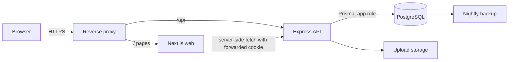

# StockWise — Architecture

Status: **Draft v0.1**. Stack as specified: Next.js (App Router) + React + TypeScript, Tailwind CSS, shadcn/ui; Express.js + Node.js + TypeScript; PostgreSQL + Prisma; pnpm workspaces; Docker Compose; Vitest, Supertest, Playwright. Versions are pinned in phase 3 after inspecting the real repository.

## 1. System context



- Browsers talk only to the proxy. The web app never touches PostgreSQL and never contains business rules.
- One origin (decision D-10): cookies are first-party and CORS is not needed in production. In development, Next.js rewrites `/api/*` to the API so the same-origin model is used everywhere.
- Public catalog pages are server-rendered by Next.js and fetch from the **public** API router only.

## 2. Monorepo layout

```
Inventory-Management-System/
├─ package.json                  # private root, scripts
├─ pnpm-workspace.yaml           # apps/*, packages/*
├─ docker-compose.yml            # postgres (+ api, web, proxy via profiles)
├─ .env.example                  # placeholders only
├─ prisma/
│  ├─ schema.prisma
│  ├─ migrations/
│  └─ seed/                      # reference, admin, demo, perf
├─ apps/
│  ├─ backend/                       # Express
│  │  └─ src/
│  │     ├─ server.ts            # boot, env validation, graceful shutdown
│  │     ├─ app.ts               # middleware order, router mounting
│  │     ├─ config/              # env.ts (zod), constants
│  │     ├─ http/                # errors, response helpers, request-id
│  │     ├─ middleware/          # session, csrf, requirePermission, validate, rateLimit, audit
│  │     ├─ lib/                 # prisma, logger, password, tokens, storage, csv
│  │     └─ modules/
│  │        ├─ auth/  users/  roles/
│  │        ├─ categories/  products/  warehouses/
│  │        ├─ inventory/        # stockService lives here
│  │        ├─ suppliers/  purchasing/
│  │        ├─ reports/  audit/  settings/
│  │        └─ public/           # separate router + serializers
│  └─ frontend/                       # Next.js App Router
│     └─ src/
│        ├─ app/
│        │  ├─ (public)/         # /, /catalog, /catalog/[...category], /p/[slug]
│        │  ├─ (auth)/login/
│        │  └─ app/              # private area: /app/dashboard, /app/products …
│        ├─ components/          # ui (shadcn), layout, data-table, forms, charts, catalog
│        ├─ lib/                 # api-client, query keys, permissions hook, format
│        └─ styles/tokens.css
├─ packages/
│  └─ shared/                    # permission keys, enums, zod schemas that are safe to share, DTO types
├─ tests/
│  ├─ integration/               # Supertest + real Postgres
│  └─ e2e/                       # Playwright
└─ docs/
```

`packages/shared` may contain only non-secret code: permission keys, enums, Zod request/response schemas, constants. The Prisma client is imported only by `apps/api`.

## 3. Backend design

**Layers (per module):** `routes → controller → service → repository`. Controllers parse and respond; services hold business rules and take the acting user; repositories wrap Prisma. Repositories are used where queries are non-trivial; simple modules may call Prisma from the service. No module imports another module's repository, only its service.

**Middleware order:** request-id → security headers (helmet) → body size limit → logger → rate limit → cookie parse → session load → CSRF check (state-changing methods) → route → `requirePermission` → `validate` (Zod for params, query, body) → controller → central error handler.

**Errors:** a small hierarchy (`ValidationError` 422, `AuthError` 401, `ForbiddenError` 403, `NotFoundError` 404, `ConflictError` 409, `RateLimitError` 429). The handler maps Prisma and Postgres errors (unique, FK, check, serialization) to those classes and returns `{ error: { code, message, details?, requestId } }`. Stack traces never leave the server.

**Start-up checks:** environment validated with Zod (process exits on failure); every registered route must declare a permission or be on the explicit public allow-list; database reachable.

**API documentation:** OpenAPI generated from the same Zod schemas, served at `/api/docs` outside production or behind `settings:manage` in production.

## 4. Authentication and session design

| Aspect | Design |
| --- | --- |
| Session | 256-bit random opaque token in cookie `sw_session` (`HttpOnly; Secure` in production; `SameSite=Lax`; `Path=/`; no domain). Only its SHA-256 hash is stored in `sessions` |
| Lifetimes | Idle 30 min (sliding, updated at most once per minute), absolute 12 h. Both configurable |
| CSRF | Double-submit token: on login a random token is returned in the body and a hash stored on the session; every POST/PATCH/PUT/DELETE must send it in `X-CSRF-Token`, and the `Origin` header must match the allowed origin. The login endpoint itself is protected by Origin check and rate limits |
| Passwords | Argon2id with parameters set from the library's current recommended defaults and reviewed in phase 4; 12-character minimum; check against a common-password list |
| Brute force | 5 failures lock the account 15 minutes; login limited per IP and per email; identical error for unknown email and wrong password; constant-time comparison |
| Revocation | Logout, password change, deactivation and admin "revoke sessions" mark sessions revoked; permission changes take effect within 60 s |
| Next.js | Server components forward the session cookie to the API; `middleware.ts` only redirects to login when the cookie is absent |

## 5. Authorization design

- `packages/shared` exports the permission keys. The seed writes the default matrix; at runtime the API loads `permissions` for the user's role from the database and caches them for 60 seconds.
- `requirePermission('products:create')` guards routes; services call `can(user, key)` for conditional behaviour (for example hiding cost fields).
- Response serializers remove cost fields unless `products:view_cost` is held.
- Full matrix and rules: `permissions.md`.

## 6. Inventory engine

All stock changes go through `stockService.apply(...)`, which implements the transaction algorithm in `database-design.md` section 5: ensure balance row → lock → check no negative → update balance → insert movement → update average cost → audit → commit. Purchase receiving, direct receipts, issues, adjustments, transfers and reversals reuse it. Idempotency keys guard against repeated submissions. A concurrency test (many parallel issues against limited stock) is mandatory in phase 7.

## 7. File storage

A `StorageProvider` interface with a local-disk implementation (private directory outside the web root, mounted volume) and room for an S3-compatible provider later. Uploads: size limit, content sniffing of the actual bytes (allow JPEG, PNG, WebP only), re-encoding to strip metadata and active content, random file names, never executed. Private images are served through an authenticated API route; images of published products are served through the public route with cache headers.

## 8. Public catalog separation

- Separate router `/api/v1/public/*`, no session, strict rate limit, short cache.
- Separate serializers with an **allow-list** of fields: id, name, slug, description, brand, image URL, category path, selling price (only if enabled), availability label (only if enabled). Contract tests assert that cost, supplier, warehouse, quantity, audit and internal ids are absent.
- Queries filter on `status = ACTIVE AND is_published = true` inside the repository so it cannot be forgotten by a caller.
- Web side: server components, `generateMetadata`, sitemap, canonical URLs, image optimisation.

## 9. Frontend design

- App Router with route groups: `(public)`, `(auth)`, and the private area under `/app`.
- Server components for public pages and initial shells; client components for interactive tables and forms.
- TanStack Query for private-area data with a central API client (adds CSRF header, normalises errors, redirects on 401). Query keys per module.
- React Hook Form with Zod resolvers using schemas from `packages/shared`.
- Table state (search, filters, sort, page) lives in the URL.
- Charts: one library (Recharts, matching shadcn chart components) wrapped in a small chart kit.
- Design system: `ui-design-system.md`.

## 10. Configuration

| Variable | Purpose |
| --- | --- |
| `NODE_ENV`, `PORT`, `LOG_LEVEL` | Runtime |
| `DATABASE_URL` | App role connection |
| `DATABASE_MIGRATION_URL` | Owner role, migrations only |
| `WEB_ORIGIN` | Allowed origin for CSRF/Origin checks (and CORS in dev if ever needed) |
| `TRUST_PROXY` | Proxy hop count for correct client IP |
| `SESSION_IDLE_MINUTES`, `SESSION_ABSOLUTE_HOURS` | Session lifetimes |
| `CSRF_SECRET` | HMAC key for CSRF tokens (min 32 chars) |
| `UPLOAD_DIR`, `MAX_UPLOAD_MB` | Storage |
| `SEED_ADMIN_EMAIL`, `SEED_ADMIN_PASSWORD` | First admin; development and first setup only |

`.env.example` contains placeholders only; all variables are validated at start-up.

## 11. Runtime and deployment

- **Local:** `docker compose up` starts PostgreSQL; web and API run with `pnpm dev` (or as compose services).
- **Production:** containers for web and API (multi-stage, non-root, healthchecks), a PostgreSQL service or managed database, a reverse proxy with automatic HTTPS and security headers, a persistent volume for uploads, scheduled backups.
- **Backups:** nightly logical dump, 30-day retention, encrypted off-site copy, restore rehearsal documented in `docs/RESTORE.md` (phase 12).
- **CI:** install, lint, type-check, unit tests, API integration tests against a Postgres service, migration-from-empty job, dependency audit, secret scan, then Playwright on main.

## 12. Testing strategy

| Layer | Tool | Focus |
| --- | --- | --- |
| Unit | Vitest | Pure logic: average cost, status transitions, normalisation, cycle detection, CSV escaping |
| API integration | Vitest + Supertest + real Postgres | Auth, 104-case permission matrix, validation, stock engine, concurrency, purchasing, serializers |
| E2E | Playwright | Login, product CRUD, receive and issue, PO receiving, public catalog, responsive checks |
| Security | Scripted checks + dependency audit + manual review | Headers, cookies, IDOR, upload abuse, rate limits |

## 13. Observability

JSON logs (pino) with request id, user id and route; redaction of passwords, cookies, tokens and CSRF values; audit events are stored in the database, not in logs. `/api/v1/health` (liveness) and `/api/v1/ready` (database check) return no version details.

## 14. Extension points (prepared, not built)

Checkout and orders (new `orders` module, public catalog products already carry slug and price), barcode scanning (barcode column and lookup endpoint exist), approval workflow for adjustments (add a request table in front of `inventory:adjust`), batch and expiry (extra columns on movements and balances), additional storage provider, two-factor authentication.
