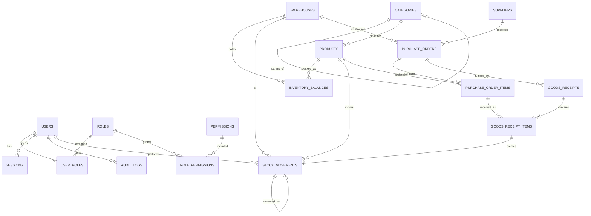

# StockWise — Database Design

Status: **Draft v0.1**. PostgreSQL, managed with Prisma migrations. Prisma cannot express every constraint, so some are added as raw SQL inside migrations (marked **raw SQL**). No versions are asserted here; they are pinned in phase 3.

## 1. Conventions

- Primary keys: UUID (`uuid`, generated by the database). Ledger tables also carry a `seq bigint GENERATED ALWAYS AS IDENTITY` column for stable ordering.
- Every table has `created_at timestamptz NOT NULL DEFAULT now()`; mutable tables also `updated_at`.
- Money: `NUMERIC(14,4)` for costs, `NUMERIC(14,2)` for selling prices. Never float.
- Quantity: `NUMERIC(14,3)`. Units that cannot be fractional are validated in the service.
- Status fields are PostgreSQL enums. Rows that carry history are archived, never deleted (`ON DELETE RESTRICT` on all business foreign keys).
- Text identifiers (SKU, barcode, email, slug) are normalised before storage and made unique after normalisation.

## 2. Entity-relationship diagram

Supporting tables without relations in the diagram: `app_settings`, `document_counters`.

## 3. Enumerations

| Enum | Values |
| --- | --- |
| `record_status` | ACTIVE, ARCHIVED (used by products, categories, warehouses) |
| `supplier_status` | ACTIVE, INACTIVE |
| `unit_of_measure` | EACH, BOX, PACK, KG, G, L, ML, M |
| `movement_type` | RECEIPT, ISSUE, ADJUSTMENT, TRANSFER_OUT, TRANSFER_IN, REVERSAL |
| `reason_code` | PURCHASE_RECEIPT, DIRECT_PURCHASE, CUSTOMER_RETURN, USAGE, SUPPLIER_RETURN, DAMAGED, COUNT_CORRECTION, TRANSFER, REVERSAL, OTHER |
| `reference_type` | PURCHASE_ORDER, GOODS_RECEIPT, TRANSFER, MOVEMENT, MANUAL |
| `po_status` | DRAFT, ORDERED, PARTIALLY_RECEIVED, RECEIVED, CANCELLED |

## 4. Tables

### 4.1 Identity and access

| Table | Columns (key points) | Constraints and indexes |
| --- | --- | --- |
| `users` | id, email, full_name, password_hash, is_active, must_change_password, failed_login_count, locked_until, last_login_at, password_changed_at, created_at, updated_at | Unique on lower-cased email (**raw SQL** unique index on `lower(email)`); password_hash never selected by default |
| `roles` | id, key, name, description, is_system | Unique `key` (ADMIN, MANAGER, INVENTORY_STAFF, VIEWER) |
| `permissions` | id, key, group_name, description | Unique `key`; seeded from the code registry (26 keys) |
| `user_roles` | user_id, role_id, granted_by, granted_at | PK `user_id` (one role per user); FKs restrict |
| `role_permissions` | role_id, permission_id | PK (role_id, permission_id) |
| `sessions` | id, user_id, token_hash, csrf_hash, created_at, last_seen_at, idle_expires_at, absolute_expires_at, revoked_at, revoked_reason, ip, user_agent | Unique `token_hash` (SHA-256 of a 256-bit random token; the raw token exists only in the cookie); index (user_id, revoked_at); index on expiry for clean-up |

### 4.2 Catalog data

| Table | Columns (key points) | Constraints and indexes |
| --- | --- | --- |
| `categories` | id, parent_id, name, slug, description, image_key, sort_order, status, created_at, updated_at | Unique `slug`; CHECK `parent_id <> id`; unique name per parent (**raw SQL** index using `COALESCE(parent_id, '0000…')`); cycle prevention in the service inside a transaction that walks ancestors |
| `products` | id, sku, barcode, barcode_normalized, name, slug, description, brand, image_key, unit (`unit_of_measure`), cost_price, average_cost, selling_price, category_id, reorder_level, status, is_published, archived_at, version, created_by, updated_by, created_at, updated_at | Unique `sku` (stored upper-case); unique `slug`; **partial unique** on `barcode_normalized` where not null (**raw SQL**); CHECK cost_price, selling_price, reorder_level >= 0; FK category RESTRICT; trigram GIN indexes on name, sku, brand for search (extension `pg_trgm`, **raw SQL**); indexes on (category_id, status), (status, is_published) |
| `warehouses` | id, code, name, address, is_default, status, created_at, updated_at | Unique `code`; **partial unique** index so only one row has `is_default = true` |
| `suppliers` | id, name, contact_person, email, phone, address, notes, status, created_at, updated_at | Unique lower-cased `name`; index on status |

`cost_price` is the reference or last agreed cost entered by users (pre-fills purchase orders). `average_cost` is maintained only by the stock engine and drives valuation.

### 4.3 Inventory

| Table | Columns (key points) | Constraints and indexes |
| --- | --- | --- |
| `inventory_balances` | product_id, warehouse_id, quantity_on_hand, updated_at | PK (product_id, warehouse_id); **CHECK `quantity_on_hand >= 0`** (**raw SQL**); index on warehouse_id |
| `stock_movements` | id, seq, product_id, warehouse_id, movement_type, quantity_delta, quantity_after, unit_cost, reason_code, reason, reference_type, reference_id, transfer_group_id, reverses_movement_id, idempotency_key, performed_by, created_at | CHECK `quantity_delta <> 0`; CHECK `quantity_after >= 0`; CHECK reason length >= 3 when type is ADJUSTMENT or REVERSAL; unique `reverses_movement_id` (a movement can be reversed once); **partial unique** (performed_by, idempotency_key) where key is not null; indexes (product_id, seq DESC), (warehouse_id, seq DESC), (performed_by, created_at), (created_at), (reference_type, reference_id); **immutable** (section 5) |

### 4.4 Purchasing

| Table | Columns (key points) | Constraints and indexes |
| --- | --- | --- |
| `purchase_orders` | id, po_number, supplier_id, warehouse_id, status, order_date, expected_date, notes, created_by, ordered_by, ordered_at, cancelled_by, cancelled_at, cancel_reason, version, created_at, updated_at | Unique `po_number` (format `PO-YYYY-NNNNNN` from `document_counters`); indexes (status, created_at), (supplier_id, created_at); CHECK cancel_reason present when CANCELLED |
| `purchase_order_items` | id, purchase_order_id, product_id, line_number, quantity_ordered, quantity_received, unit_cost | Unique (purchase_order_id, product_id); CHECK quantity_ordered > 0; CHECK quantity_received >= 0; CHECK unit_cost >= 0; over-receipt limit enforced in the service using the tolerance setting |
| `goods_receipts` | id, receipt_number, purchase_order_id, warehouse_id, received_by, received_at, delivery_note_ref, notes, created_at | Unique `receipt_number`; index (purchase_order_id) |
| `goods_receipt_items` | id, goods_receipt_id, purchase_order_item_id, product_id, quantity_received, unit_cost, stock_movement_id | CHECK quantity_received > 0; unique `stock_movement_id` |

### 4.5 Audit, settings, numbering

| Table | Columns (key points) | Constraints and indexes |
| --- | --- | --- |
| `audit_logs` | id, seq, actor_user_id, action, entity_type, entity_id, before (jsonb), after (jsonb), ip (inet), user_agent, request_id, created_at | Indexes (entity_type, entity_id), (actor_user_id, created_at), (action, created_at), (created_at); **immutable** (section 5); secrets redacted before insert |
| `app_settings` | key, value (jsonb), updated_by, updated_at | PK `key`; keys include `currency_code`, `public_show_prices`, `public_show_availability`, `over_receipt_tolerance_percent`, `default_low_stock_threshold` |
| `document_counters` | scope, year, last_value | PK (scope, year); incremented with `UPDATE … RETURNING` inside the creating transaction |

## 5. Integrity enforcement

1. **Immutable ledger (raw SQL).** `BEFORE UPDATE OR DELETE` triggers on `stock_movements` and `audit_logs` raise an exception. `TRUNCATE` is also blocked by a statement-level trigger.
2. **Database roles (raw SQL).** Two roles: an *owner/migration* role (runs migrations, never used by the running API) and a *least-privilege app* role (`SELECT/INSERT/UPDATE/DELETE` only on the tables it needs; `INSERT, SELECT` only on `stock_movements` and `audit_logs`; no DDL, no `SUPERUSER`, no `CREATEROLE`).
3. **Stock write algorithm** (implemented once in `stockService`, all stock endpoints call it):
   1. Start a transaction (isolation READ COMMITTED is sufficient because of the row locks).
   2. `INSERT … ON CONFLICT DO NOTHING` the balance row (zero quantity) so a row always exists.
   3. `SELECT … FOR UPDATE` the balance row(s). For transfers lock both rows in a fixed order (by warehouse id) to avoid deadlocks.
   4. Compute `quantity_after`; reject with 409 if it would be negative.
   5. Update the balance; insert the movement(s) with `quantity_after`, actor, reason; update `average_cost` when the movement is a costed receipt.
   6. Insert the audit row in the same transaction. Commit.
4. **Idempotency.** If an `Idempotency-Key` repeats for the same user, the original result is returned instead of a second movement.
5. **Reconciliation.** `pnpm db:reconcile` and an integration test check that for every (product, warehouse): `inventory_balances.quantity_on_hand = SUM(quantity_delta)`, and that the latest `quantity_after` equals the balance. A mismatch fails the check.

## 6. Valuation, cancellations, corrections, returns

**Method: weighted average cost, per product (all warehouses together).**

- On a costed receipt (goods receipt or direct receipt with a unit cost):
  `new_average = (total_on_hand_before × average_cost + received_qty × unit_cost) ÷ (total_on_hand_before + received_qty)`; the new value is stored on `products.average_cost`, rounded to 4 decimals. If total on hand before is 0, the average equals the receipt cost.
- Issues, negative adjustments and transfers are valued at the current `average_cost`; the value is snapshotted into `stock_movements.unit_cost`. Transfers do not change the average.
- Positive adjustments and customer returns are valued at the current average unless a unit cost is supplied by a user holding `products:view_cost`.
- **Inventory valuation** = Σ over balances of `quantity_on_hand × products.average_cost`, reported by category and warehouse. It is a point-in-time value computed from current data.

**Cancellations.** A purchase order in DRAFT or ORDERED can be cancelled (reason required). A PARTIALLY_RECEIVED order can be cancelled to close the unreceived remainder; its receipts and movements stay. Cancelling never touches stock.

**Corrections.** A wrong receipt or issue is corrected by a REVERSAL movement that links to the original (`reverses_movement_id`) with a mandatory reason; the original is untouched. If the original belongs to a goods receipt item, the reversal also reduces `quantity_received` and recalculates the PO status. A reversal is valued at the current average cost (the average is **not** recomputed retroactively). This is a known simplification, recorded here so reports are explained consistently.

**Returns.** A customer return is a RECEIPT with reason code CUSTOMER_RETURN. A return to supplier is an ISSUE with reason code SUPPLIER_RETURN. Both are ordinary ledger rows.

## 7. Seed plan

| Seed | Content | Environment |
| --- | --- | --- |
| Reference | 26 permissions, 4 roles, role-permission matrix from `permissions.md`, default settings, one default warehouse | All (idempotent, safe to run twice) |
| Admin | One ADMIN user from `SEED_ADMIN_EMAIL`; password from environment, `must_change_password = true` | Dev and first production setup |
| Demo data | 30 categories (own naming, inspired by the reference's breadth), 3 suppliers, 200 products, sample movements and purchase orders | Development and test only |
| Performance data | Script generating 20,000 products and several hundred thousand movements | Opt-in, local only |

## 8. Migration rules

- One migration per change; migrations apply cleanly on an empty database (CI job) and are never edited after merge.
- Raw SQL parts (extensions, triggers, partial indexes, CHECKs, grants) live in the same migration files with comments.
- Destructive changes follow expand-then-contract.
- The running API uses `DATABASE_URL` (app role); migrations use `DATABASE_MIGRATION_URL` (owner role).
